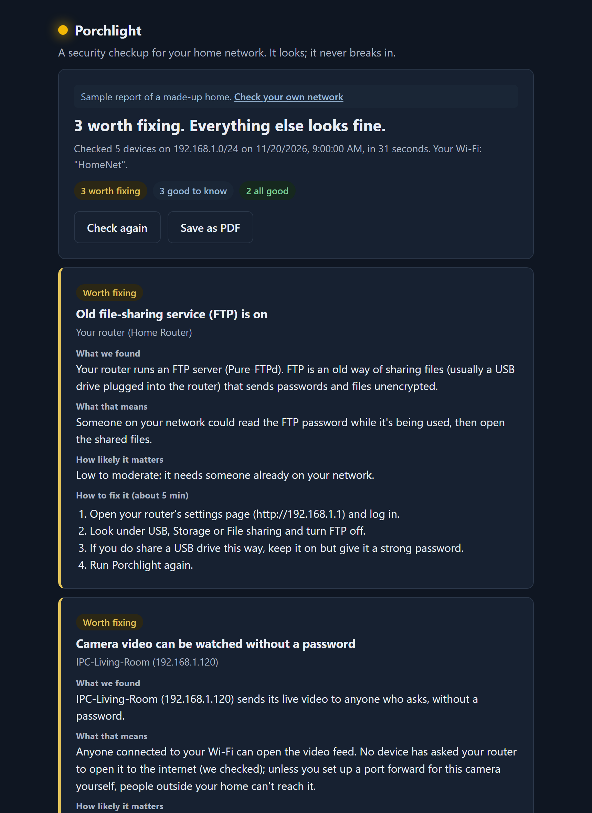
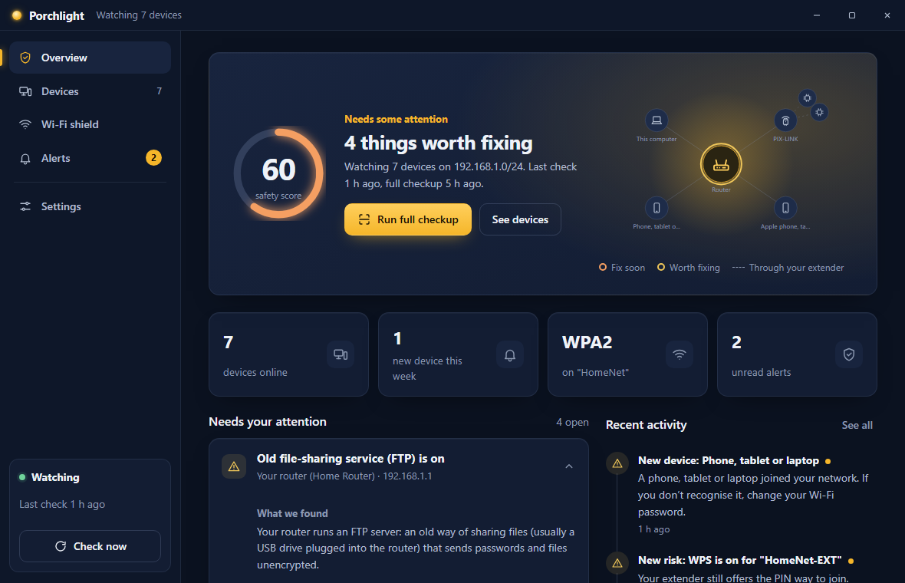

# Porchlight

**A security checkup for home and office networks, written so anyone can act on it.**
It finds the devices on your network, looks for the problems that actually get homes and small offices into trouble,
and explains each one in plain words: what we found, what it means, how likely it is to matter, and how to fix it.
For IT staff, every finding also has a stable ID, a severity, the observed technical details, and the related CIS
Controls v8 safeguards.

It looks; it never breaks in. Windows and Linux, no dependencies, no account, and nothing about you leaves your computer
([privacy notes](https://porchlight-beryl.vercel.app/privacy/)).

**Website:** [porchlight-beryl.vercel.app](https://porchlight-beryl.vercel.app) · **Live demo** (a made-up home, nothing is scanned): [porchlight-beryl.vercel.app/demo](https://porchlight-beryl.vercel.app/demo/)



*Sample report of a made-up home. Open `http://localhost:7377/?demo` to see it in the panel.*

## Porchlight for Windows: the app



**[Download Porchlight 0.6.5 for Windows](https://porchlight-beryl.vercel.app/download/Porchlight_0.6.5_x64-setup.exe)** (3 MB, Windows 10 and 11, installs per user without admin rights). In English, French and Arabic: it follows Windows, or pick one in Settings.

A tray app written in Rust ([Tauri](https://tauri.app)) that keeps watching your home network in the background and
sends a notification when something changes:

- **A new device joins your network**, with any risky open doors found on it right away. Devices are named from
  everything they announce: the name they gave your router when they joined (read from the router's own DNS), the
  names they advertise for their services ("Living Room TV", "Sara's iPhone"), mDNS, NetBIOS, UPnP and their own web
  page, plus their maker from the built-in IEEE registry. Devices that announce nothing are asked again every hour,
  get a clear label ("Phone, tablet or laptop (.39)"), and a one-click name that Porchlight remembers.
- **Something pretends to be your router**: another device answering with the router's hardware address, or the
  router's identity changing (how ARP-spoofing "man-in-the-middle" attacks start).
- **Someone keeps kicking this computer off the Wi-Fi**: Porchlight listens to live Wi-Fi connection events and warns
  when the computer drops off and reconnects again and again with a good signal, the pattern of a deauthentication
  ("kick-off") attack, then looks for a fake copy of your network straight away.
- **A fake copy of your Wi-Fi appears** with weaker protection (an "evil twin").
- **Your DNS is tampered with**: the DNS servers change, another device on the network answers lookups in the
  router's place, or the DNS invents answers for websites that don't exist.
- **Wi-Fi shield:** protection type, WPS, kick-off protection (802.11w management frame protection), and the open
  networks this computer would join by itself, which is what MANA and KARMA fake-hotspot attacks rely on. Read straight
  from the Windows Wi-Fi API, no monitor mode or admin rights needed.
- **IPv6:** whether devices have public IPv6 addresses (so the router's IPv6 firewall matters), and whether more than
  one device announces itself as the IPv6 router.
- A daily full checkup of every device: Telnet, FTP, SMBv1, Remote Desktop without NLA, open camera streams, Android
  debugging, Docker, VNC, and ports opened to the internet through UPnP.
- **A device you don't recognise:** press "I don't know it" and Porchlight shows how to get it off your network:
  change the Wi-Fi password (the sure way), or block it by its hardware address in the router. Porchlight itself never
  logs in to the router or pushes devices off: it only looks.

**One thing at a time.** The window opens on a plain sentence ("Your home is mostly safe.") and the single next
thing to do, lit up, with numbered steps and how long it takes. "I did it, check again" runs the checkup again and
tells you whether the fix worked; "It's fine, stop telling me" keeps something you chose on purpose out of your score
and your alerts. A new device asks "Is it yours?", and one you don't recognise comes with the steps to send it away.

The map stays readable up to about 75 devices (rings around the router, the ones that need attention closest) and
works with the keyboard. The window passes an automated accessibility audit (axe-core, every view, light and dark).

**Updates are signed.** Porchlight checks once a day and only installs an update when you choose, and only if its
signature matches the key built into the app ([how signing works](docs/SIGNING.md)). The app and installer are
code-signed by the author (certificate thumbprint `6250EBA6F952FFD7AAB36CC154ECC1DB1CA1C486`, public half in
[docs/porchlight-codesign.cer](docs/porchlight-codesign.cer)), so you can check that nothing changed after release.
The certificate is self-signed, not from an authority Windows already trusts, so SmartScreen may still warn the
first time (More info → Run anyway).

**Privacy:** no account, no analytics, no telemetry. Everything stays in two files on your computer
(`%APPDATA%\com.aboutbeyrem.porchlight`); Settings → Forget everything deletes them. The only connections that
leave your network are a daily update check and one DNS test lookup for a made-up name, listed in the
[privacy notes](https://porchlight-beryl.vercel.app/privacy/).

**Testing it?** See [docs/BETA.md](docs/BETA.md). Settings → Help → Save diagnostic file writes an anonymised summary
(counts and check IDs, never names or addresses) to attach to an issue.

Build it yourself from `app/`: install Rust, then `npx @tauri-apps/cli build`.

The command-line checkup below (Node.js) is the office edition: it adds the office profile, policy files, CIS
mapping and HTML/CSV reports, and runs on Linux too.

## What it checks

| Check | What it tells you |
|---|---|
| **Devices on your network** | What's connected, named from what each device announces: UPnP, mDNS (phones, TVs, printers), NetBIOS (Windows PCs), its web page title, and the maker's name when a vendor list is on your computer. Phones with private Wi-Fi addresses and devices connected through a repeater are recognised as such. |
| **Open doors** | 18 common services: Telnet, FTP, VNC, Remote Desktop, MQTT, Android debugging (ADB), Docker, camera and recorder services, web pages. |
| **Cameras** | Whether a camera streams its video (RTSP) to anyone who asks, without a password. |
| **Doors opened to the internet** | Whether devices asked your router to open ports to the internet on their own (UPnP), and which. |
| **Router settings page** | Whether it's offered over an encrypted connection. |
| **Your Wi-Fi protection** | WPA3, WPA2, WPA, WEP or none, for your main network, a second network from the same router, and your extender's network. Never your neighbours'. |
| **WPS** | Whether your access points announce WPS, the PIN-based way to join, read from what they broadcast. |
| **Fake copies of your Wi-Fi** | Whether an access point that isn't yours broadcasts your Wi-Fi's name, especially with weaker protection. Works from the normal list of nearby networks, no monitor mode needed. |
| **This computer's firewall** | Whether Windows Firewall is on for the network you're using. |
| **Wi-Fi adapters and monitor mode** | Whether you have an adapter that can do monitor mode, and whether it's on right now. |
| **Windows file sharing (SMB)** | Whether a device still accepts SMBv1 (the WannaCry-era protocol), read from the SMB negotiation without logging in. |
| **Remote Desktop** | Whether Remote Desktop lets people reach the sign-in screen without Network Level Authentication. |
| **Databases without passwords** | Redis that answers `PING` and Elasticsearch that shows its cluster without asking for a password; Memcached. |

### Between checkups

Porchlight remembers, on your computer only, which devices it saw and what it found. The next checkup tells you when
**a new device joined** your network and **what you fixed**. A problem only counts as fixed when Porchlight could look
again: an extender that was asleep isn't a fixed one. `--no-history` turns this off and `--forget` deletes it.

### The panel

A score out of 100 (only real problems cost points), a map of your network where tapping a device shows what was
found on it, filters by level, and a report you can save as a PDF.

## For offices

`--profile office` (or Office on the panel's first screen) adds the checks an IT team cares about:

| Office check | What it tells you |
|---|---|
| **SMB signing** | Whether file sharing requires signed messages, which blocks SMB relay attacks. |
| **TLS and certificates** | TLS 1.0/1.1 still accepted, expired or soon-expiring certificates, self-signed certificates, keys under 2048 bits. |
| **Databases on the network** | MySQL, PostgreSQL, SQL Server, MongoDB, CouchDB, Redis, Elasticsearch and Memcached reachable from the whole network. |
| **More ports** | LDAP, WinRM, raw printing, HTTPS on 8443, and the database ports, four at a time per device. |
| **Known devices** | With a policy file, any device not on your inventory is flagged (CIS Controls 1.1 and 1.2). |

### Policy file

A JSON policy describes your organisation's checkup: scope, who authorised it, known devices, and reviewed risks.
`node bin/porchlight.js --init-policy porchlight-policy.json` writes an example:

```json
{
  "organization": "Example Ltd",
  "profile": "office",
  "authorizedBy": "Jane Doe, IT manager",
  "ranges": ["192.168.10.0/24"],
  "failOn": "worth-fixing",
  "knownDevices": [{ "mac": "aa:bb:cc:dd:ee:01", "name": "Reception printer" }],
  "accepted": [{ "id": "PL-CERT-SELFSIGNED", "device": "192.168.10.20", "reason": "Printer admin page", "until": "2027-06-30", "by": "Jane Doe" }]
}
```

- **Accepted risks** stay in the report, marked with who accepted them, why, and until when. They don't count against
  the score or the exit code. When the date passes, the finding counts again and the report says the acceptance
  expired.
- **Ranges** can be any private address space (10/8, 172.16/12, 192.168/16), up to 4,096 addresses per run, and need
  `authorizedBy`, which is printed in every report. Public internet addresses are refused.

### Reports and automation

```bash
node bin/porchlight.js --scan --policy porchlight-policy.json --out report.html --out findings.csv
```

- **HTML**: a self-contained report for managers and auditors (summary, scope and authorisation, findings by
  severity, accepted risks, device inventory). No scripts, prints cleanly.
- **CSV**: one row per finding with ID, severity, status, device, fix steps, technical details and CIS mapping, for
  spreadsheets and ticketing. Cells that could run as spreadsheet formulas are neutralised.
- **Markdown** and **JSON** for wikis and other tools.
- **Exit codes**: `0` done, `1` an unaccepted finding at or above `failOn`, `2` wrong options, `3` the checkup couldn't
  run. Schedule it weekly with Task Scheduler or cron and you'll notice when something changes.

Every check, its ID and its CIS Controls v8 mapping are listed in [docs/CHECKS.md](docs/CHECKS.md).

## How a finding reads

Every finding has four parts, and a level that's honest about urgency: **Fix soon**, **Worth fixing**,
**Good to know** or **All good**. Risk is described as "who would need to do what", never as a worst-case story.

> **WPS is on for "HomeNet-EXT"** (Worth fixing)
> **What we found:** "HomeNet-EXT" (broadcast by your PIX-LINK extender at 192.168.1.115) announces WPS, the "press a
> button or type an 8-digit PIN to connect" feature. WPS is already off on "HomeNet".
> **What that means:** The PIN part of WPS has a known design weakness: on some devices, someone within Wi-Fi range
> can work out the PIN with free tools and get the Wi-Fi password, however long it is. The push-button part is fine.
> **How likely it matters:** Low to moderate: it needs someone within range of your Wi-Fi, and it only works on some
> models. Turning WPS off costs nothing unless you connect devices with the WPS button.
> **How to fix it:** Open your extender's settings page and log in. Find WPS and turn it off. Run Porchlight again.

## What it never does

The full list of what Porchlight sends on a network is in [SECURITY.md](SECURITY.md).

- **Only networks you're allowed to check.** By default, the network this computer is on, after you confirm it's
  yours. Other private ranges need the name of the person who authorised it.
- **Never logs in.** No password guessing, no default-password tries, no cracking.
- **Never attacks.** No flooding, no deauthentication, no jamming, no exploits. The home profile checks one port at a
  time per device, so small devices keep working normally.
- **Nothing leaves your computer.** No account, no cloud, no tracking. The panel only answers on `localhost` and
  refuses requests from other websites.

## Run it

You need [Node.js](https://nodejs.org) 20 or newer. Nothing else to install.

```bash
git clone https://github.com/aboutbeyrem/porchlight
cd porchlight
node bin/porchlight.js
```

Then open <http://localhost:7377>, confirm it's your network, pick your Wi-Fi name, choose Home or Office, and start
the checkup. It takes about 30 seconds for a typical home. To use a policy file in the panel, start it with
`node bin/porchlight.js --policy porchlight-policy.json`.

Prefer the terminal:

```bash
node bin/porchlight.js --scan --this-is-my-network --wifi "Your Wi-Fi name"
```

Add `--json` for a machine-readable report, `--no-history` to skip remembering devices, or run
`node bin/porchlight.js --forget` to delete what it remembers (stored in `~/.porchlight`). `--help` lists everything.

**Windows** uses built-in tools (`route`, `arp`, `netsh`) and a small PowerShell helper,
[`src/win/wlan-bss.ps1`](src/win/wlan-bss.ps1), that reads Wi-Fi beacons through the Windows Wi-Fi API. No admin
rights needed.
**Linux** uses `ip`, `iw` and `nmcli` (NetworkManager), which most desktops already have.

## What's next

Ideas for coming versions, from phone alerts to Wi-Fi channel advice and a 24/7 Raspberry Pi watcher, are in
[docs/ROADMAP.md](docs/ROADMAP.md).

## Honest limits

- **It's a first-line checkup, not a certified compliance scanner or a penetration test.** It finds common, fixable
  problems quickly and explains them; it doesn't replace a professional audit, a vulnerability scanner with a CVE
  database, or patch management.
- It checks 18 common ports at home and 31 in the office profile, not every port.
- It never tries passwords, so it can't tell whether a device still has its factory password. It reminds you to check.
- Devices that are asleep or ignore everything (phones often do) may not show up.
- It covers IPv4 only: the computer's own network, or private ranges up to 4,096 addresses per run. IPv6 isn't
  checked yet. Devices in other subnets are found by knocking on common ports, so a host with every one of those
  ports silently filtered won't show up.
- **Office checks:** SMB, TLS and certificate checks were run live against a Windows 10 PC and a home router. The
  Remote Desktop, Redis, MySQL and Elasticsearch checks are tested against fake servers that speak the real protocols,
  but haven't been run in a real office network yet.
- It can't see port forwards you set up by hand in your router, only ones devices opened through UPnP.
- WPS and Wi-Fi protection are read from networks this computer can hear. An extender in another room may need a
  check from closer.
- On Windows, monitor-mode support comes from what the adapter's driver reports.
- **Linux:** the Linux code is covered by tests on sample command output, but it hasn't been run end to end on a Linux
  machine yet.
- Fake-copy detection compares access points by name and hardware address. A copy that also clones your router's
  hardware address can't be told apart this way.
- Device makers are only named when a vendor list (from Wireshark, Nmap or the ieee-data package) is on the computer.
  Porchlight never downloads one.
- **Kick-off detection** (Windows app) sees this computer's own Wi-Fi connection, not the air around it: it notices
  an attack aimed at this computer, not one aimed only at another device. A very unstable signal can look similar,
  so it stays quiet when the signal is weak.
- **Device names can't be guaranteed.** Porchlight uses every name a device announces anywhere; a phone that hides
  its name and uses a private address announces nothing at all. Those devices get a descriptive label and a one-click
  name, and are asked again every hour.
- IPv6 checks are about this computer's view: they can't test from outside whether the router's IPv6 firewall
  actually blocks incoming connections.

## Tested on a real home

Run on a real home network (Windows 10, Ethernet, plus an ALFA AWUS036ACS USB Wi-Fi adapter). It found an FTP server
and SMBv1 still enabled on the router, found WPS switched on in a Wi-Fi extender while the main network had it off,
named the extender from its own web page, and confirmed that the router doesn't let devices open ports to the
internet by themselves, that no copy of the home Wi-Fi was nearby, and that the computer's firewall was on. The office
profile, with a test policy, flagged SMB signing not being required on the PC and two phones not on the inventory.

Testing there also changed the design:

- The extender ignored every connection when eight arrived at once, which hid its open ports. Porchlight now checks
  one port at a time per device.
- A Windows scan sometimes missed the extender's network, and once that produced a false "no password" warning.
  Missing information is now always "unknown", never "open", and the protection type is read from what the access
  point itself broadcasts.
- The extender gives every device connected through it its own MAC address, so a phone behind it looked like a second
  extender. Porchlight now spots shared addresses and labels those devices as being on the extender.
- An extender that was asleep made its WPS problem disappear, which first showed up as "fixed". Now a problem only
  counts as fixed when its device answered and its Wi-Fi network was heard again.
- A home checkup right after an office one reported the office-only findings as "fixed". Now a problem only counts as
  fixed when the check that found it actually ran again.

## Tests

```bash
npm test
```

The Node.js engine has 74 tests: parsers for every command's output (English and French Windows), mDNS and NetBIOS answers, the rules and
tone of every finding (no scare words), fake copies of a network (including one that tries to vouch for itself through
a neighbour's router), memory between checkups, fake SMB, Remote Desktop, Redis, camera and FTP servers on
`127.0.0.1`, policy validation and accepted risks, private-range limits, report escaping (HTML and CSV formula
injection), and the panel's security (DNS rebinding, cross-site requests, consent, path traversal).

The sample report is built by the real rules from a made-up home: `node scripts/make-demo.js`.

The Windows app has 76 Rust tests (`cargo test` in `app/src-tauri`): the decisions behind every alert (router
impersonation, new devices, new risks, the first-look baseline, merging a finished check with what the user did
meanwhile), the kick-off detector's timing rules, fake-copy clustering (second bands, extenders, invisible
characters, a copy that tries to pass as the real network), Wi-Fi beacon parsing, DNS and mDNS message parsing,
naming rules, and the diagnostic file never containing names or addresses. Live tests against a real network run
with `cargo test -- --ignored`.

## How it was made

The idea, the rules and the tone are mine, written down in [PLAN.md](PLAN.md) before any code, and I tested it on my
own home network. The code was written by Claude Code (an AI coding agent by Anthropic) working from that plan.

## License

MIT. See [LICENSE](LICENSE).

Made by [Beyrem Oueslati](https://www.aboutbeyrem.com).
